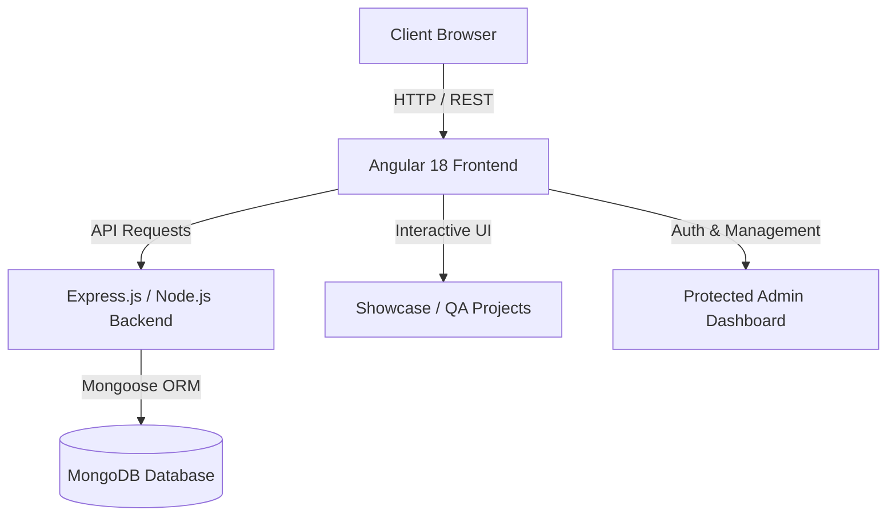

# 🌟 Ibrahim A. Hamada — Portfolio & QA Automation Showcase

<div align="center">


<br/>

[](https://angular.dev/)
[](https://nodejs.org/)
[](https://expressjs.com/)
[](https://mongodb.com/)
[](https://selenium.dev/)
[](https://testng.org/)

<p align="center">
  <b>Production-grade Full-Stack Portfolio and QA Test Automation Showcase</b><br>
  Built with <b>Angular 18</b> Standalone Architecture, <b>Node.js / Express</b> REST API, and <b>MongoDB</b> with an interactive admin management dashboard.
</p>

[🌐 Live Portfolio](https://ibrahimahamada27.github.io/My-Protofolio/) • [💼 LinkedIn Profile](https://www.linkedin.com/in/ibrahim-a-hamada-0ba411287/) • [📧 Email Contact](mailto:ibrahima.hamada277@gmail.com)

</div>

---

## 📌 Table of Contents
- [✨ Key Features](#-key-features)
- [🏗️ System Architecture](#️-system-architecture)
- [🚀 Featured Projects & QA Suites](#-featured-projects--qa-suites)
- [🛠️ Tech Stack & Skills](#️-tech-stack--skills)
- [⚙️ Local Installation & Setup](#️-local-installation--setup)
- [📦 Deployment](#-deployment)
- [📬 Contact & Connect](#-contact--connect)

---

## ✨ Key Features

- **💎 Modern Glassmorphism & Cyber-Navy UI**: High-end modern UI with fluid animations, glowing gradients, responsive cards, and dynamic interactions.
- **🧪 QA & Automation First**: Showcases practical QA frameworks (Selenium, Java, TestNG, POM, Postman, API and database testing).
- **📂 Full-Featured Projects Showcase**: 12+ real-world applications including medical portals, 3D WebGL experiences, e-commerce, and commercial cafe systems.
- **🛡️ Secure Admin Dashboard**: Protected dashboard (JWT authentication & bcrypt) for managing projects, experiences, certificates, and site information.
- **⚡ Serverless & Standalone Ready**: Engineered with smart fallback state handling so the frontend is 100% functional both with MongoDB or as a static site.
- **📱 Fully Responsive**: Pixel-perfect design tailored for mobile phones, tablets, laptops, and ultra-wide displays.

---

## 🏗️ System Architecture



### Directory Structure
```text
My-Protofolio/
├── backend/
│   ├── middlewares/        # JWT Authentication & security middlewares
│   ├── models/             # Mongoose Schemas (Project, Experience, Skill, etc.)
│   ├── routes/             # RESTful API endpoints
│   ├── index.js            # Express server & CORS configuration
│   ├── seed.js             # Database seeding script with curated data
│   └── vercel.json         # Serverless deployment configuration
├── frontend/
│   ├── src/
│   │   ├── app/
│   │   │   ├── core/       # Services, models, and interceptors
│   │   │   ├── dashboard/  # Admin management portal
│   │   │   ├── layout/     # UI Sections (Projects, About, Skills, Experience, etc.)
│   │   │   └── shared/     # Modal, navigation, and reusable components
│   │   └── styles.css      # Core theme, variables, and glassmorphism styling
│   └── angular.json        # Angular CLI configuration
└── README.md
```

---

## 🚀 Featured Projects & QA Suites

| # | Project Name | Tech Stack | Description | Repository |
|---|---|---|---|---|
| **1** | **DEPI E-Commerce QA Automation** | `Java`, `Selenium`, `TestNG`, `POM`, `Allure` | Automated end-to-end testing suite for Noon, DeFacto, and Seoudi with data-driven tests. | [GitHub](https://github.com/IbrahimAHamada27/graduation-project-from-depi) |
| **2** | **Dar Al-Yusr Clinics** | `TypeScript`, `Angular`, `TailwindCSS`, `REST API` | Full-scale medical clinics platform with doctor schedules, booking, and clinic workflows. | [GitHub](https://github.com/IbrahimAHamada27/Dar-AlYusr-Clinics) |
| **3** | **Hedera Hashgraph 3D Experience** | `React`, `Three.js`, `R3F`, `Framer Motion` | Interactive 3D educational web app visualizing Hedera consensus and live HBAR simulations. | [GitHub](https://github.com/IbrahimAHamada27/hedera-hashgraph-interactive-session) |
| **4** | **Dr. Ibrahim Elsharkawy Portal** | `TypeScript`, `Modern Web`, `SEO` | Medical practitioner digital portal for consultation inquiries and clinic service showcases. | [GitHub](https://github.com/IbrahimAHamada27/Dr.Ibrahim_Elsharkawy) |
| **5** | **Dr. Aml Abd ELsattar Profile** | `TypeScript`, `Modern UI/UX`, `CSS3` | Clinical healthcare platform with interactive service portfolios and booking workflows. | [GitHub](https://github.com/IbrahimAHamada27/-Dr.Aml-Abd-ELsattar-) |
| **6** | **Vexa SaaS & AI Platform** | `TypeScript`, `Next.js`, `TailwindCSS` | High-performance SaaS application with glassmorphic UI components and AI integrations. | [GitHub](https://github.com/IbrahimAHamada27/vexa) |
| **7** | **Athr Baqy Platform** | `TypeScript`, `Web`, `Accessibility` | Digital platform for charitable initiatives, live impact metrics, and community engagement. | [GitHub](https://github.com/IbrahimAHamada27/-AthrBaqy) |
| **8** | **El-Koptan Mobile Store** | `TypeScript`, `E-Commerce UI`, `REST API` | Smartphone & accessories e-commerce storefront with filtering and cart management. | [GitHub](https://github.com/IbrahimAHamada27/ElKoptanMobileStore) |
| **9** | **The Face Coffee QR System** | `Python`, `FastAPI / Flask`, `QR System` | Commercial digital cafe ordering system and interactive digital QR menu. | [GitHub](https://github.com/IbrahimAHamada27/thefacecoffee) |
| **10**| **Full-Stack E-Commerce & QA** | `TypeScript`, `Node.js`, `Express`, `Postman` | Multi-vendor shopping platform with comprehensive manual & automated test coverage. | [GitHub](https://github.com/IbrahimAHamada27/E-commerce) |
| **11**| **Double Shot Cafe Experience** | `HTML5`, `CSS3`, `JavaScript` | Commercial cafe showcase featuring responsive visual menus and signature drink cards. | [GitHub](https://github.com/IbrahimAHamada27/double.shot) |
| **12**| **Luxury Wedding RSVP Suite** | `HTML5`, `CSS3 Keyframes`, `Audio API` | Interactive luxury RSVP invitation with real-time countdowns and multimedia audio. | [GitHub](https://github.com/IbrahimAHamada27/Mostafa_And_Yasmine_Wedding_Invitation) |

---

## 💼 Professional Services Offered

- 🧪 **Test Automation & QA Engineering**: Robust test frameworks using Selenium WebDriver, Java, TestNG, POM, and Allure.
- 🔌 **RESTful API Testing & Validation**: API endpoint testing with Postman, automated test collections, status & schema validation.
- 📋 **Manual QA & Quality Assurance**: ISTQB-aligned test plans, exploratory testing, boundary value analysis, and defect lifecycle tracking.
- 🌐 **Full-Stack Web Development (MEAN Stack)**: Scalable web applications using Angular 18, Node.js, Express.js, TypeScript, and MongoDB.
- 🏥 **Healthcare Portals & Business Web Apps**: Custom clinical management platforms, doctor scheduling, and high-conversion client websites.
- 🧊 **Interactive 3D & WebGL Experiences**: Immersive educational and commercial web apps with Three.js, React Three Fiber, and Framer Motion.

---

## 🛠️ Tech Stack & Skills

- **Testing & QA**: Selenium WebDriver, TestNG, Java Automation, Postman, Manual Testing, ISTQB Methodologies, Defect Lifecycle, Page Object Model (POM), Allure Reporting.
- **Frontend Development**: Angular 18 (Standalone Components, Signals, RxJS), TypeScript, JavaScript (ES6+), HTML5, CSS3, SCSS, TailwindCSS, Three.js, AOS Animations.
- **Backend & Database**: Node.js, Express.js, MongoDB, Mongoose ORM, RESTful API Design, JWT Auth, Python (Flask/FastAPI).
- **Tools & DevOps**: Git, GitHub, Maven, Postman, VS Code, Vercel, Render.

---

## ⚙️ Local Installation & Setup

### Prerequisites
- [Node.js](https://nodejs.org/) (v18 or higher)
- [MongoDB](https://www.mongodb.com/) (Local or MongoDB Atlas connection string)
- [Angular CLI](https://angular.dev/) (`npm install -g @angular/cli`)

### 1. Clone the Repository
```bash
git clone https://github.com/IbrahimAHamada27/My-Protofolio.git
cd My-Protofolio
```

### 2. Backend Setup
```bash
cd backend
npm install

# Create .env file with:
# PORT=3000
# MONGODB_URI=mongodb://127.0.0.1:27017/portfolio_db
# JWT_SECRET=your_secret_key_here

# Seed initial projects, skills, and site data
npm run seed

# Run backend in development mode
npm run dev
```

### 3. Frontend Setup
```bash
cd ../frontend
npm install

# Run frontend development server
ng serve
```
Open `http://localhost:4200/` in your browser.

---

## 📦 Deployment

- **Frontend**: Deployed via **Vercel** or **GitHub Pages**.
- **Backend**: Deployed via **Vercel Serverless** / **Render**.
- **Database**: Cloud hosted on **MongoDB Atlas**.

---

## 📬 Contact & Connect

- **Name**: Ibrahim A. Hamada
- **Title**: QA Engineer & Full-Stack Developer
- **Email**: [ibrahima.hamada277@gmail.com](mailto:ibrahima.hamada277@gmail.com)
- **LinkedIn**: [linkedin.com/in/ibrahim-a-hamada-0ba411287](https://www.linkedin.com/in/ibrahim-a-hamada-0ba411287/)
- **GitHub**: [github.com/IbrahimAHamada27](https://github.com/IbrahimAHamada27)

<div align="center">
  <sub>Designed & Developed by <b>Ibrahim A. Hamada</b> © 2026. All rights reserved.</sub>
</div>
